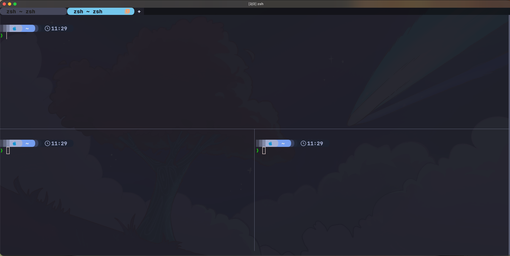
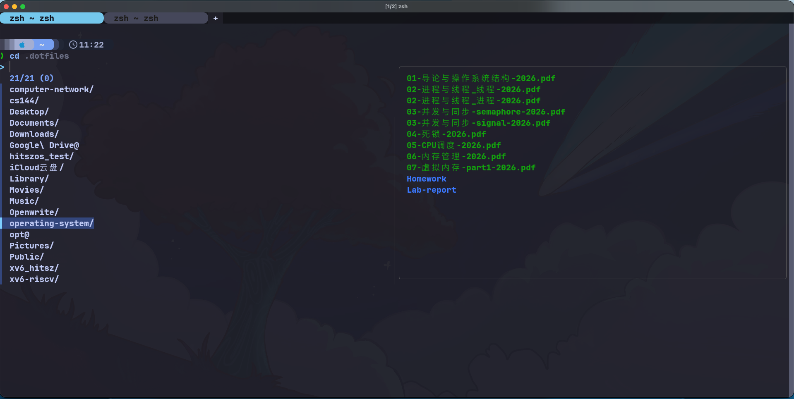
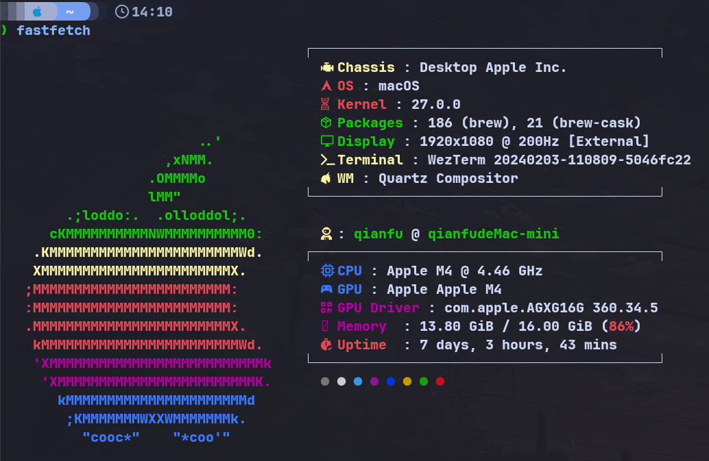
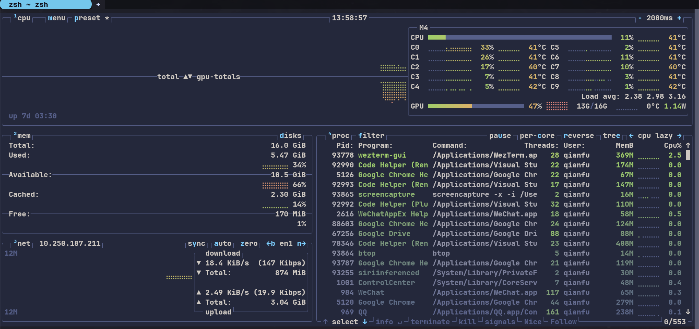

去年在 Linux 101 曾经做过一次配置分享，但是那次为了照顾新手（为了偷懒），用了开箱即用的 Fish 进行讲解，这次讲解我日常用的 Wezterm+zsh 配置，主打一个美观。另外也是看到 MacBook 配置指北,讲的有些笼统，故而想写一期。另外，本文全部的主题配置采用 Tokyo-night 风格或与其相似的风格（喜欢冷峻色调的可以参考），以下是实景图截取:



## 1. 先分清 Terminal、Shell 和提示符

| 层次         | 本文选择    | 负责什么                                 |
| ------------ | ----------- | ---------------------------------------- |
| Terminal     | WezTerm     | 窗口、字体、配色、标签页、分屏和键盘输入 |
| Shell        | zsh         | 解释命令、变量、管道、补全和历史记录     |
| 插件管理器   | zinit       | 下载、加载和更新 zsh 插件                |
| Prompt提示符 | Starship    | 显示当前路径、Git 状态、语言环境和时间   |
| 命令行工具   | fzf、eza 等 | 搜索、浏览文件、跳转目录和查看系统状态   |

例如，WezTerm 的背景图片由 Lua 配置控制，输入命令时的语法高亮由 zsh 插件控制，路径前面的彩色提示符则由 Starship 控制。调整外观时，先确定自己要改的是哪一层。

## 2. 安装工具

安装列表中也包含文件查找工具 `fd`，可以按需使用。本文的 Tab 搜索候选由 zsh 补全系统提供，zsh 插件统一通过 zinit 安装。

### 2.1 macOS

```bash
brew install --cask wezterm font-jetbrains-mono-nerd-font
brew install git curl fzf fd eza zoxide bat fastfetch btop starship
```

macOS 已自带 zsh，不必重复安装 zsh

### 2.2 Arch Linux

```bash
sudo pacman -Syu --needed wezterm zsh git curl fzf fd eza zoxide bat fastfetch btop starship ttf-jetbrains-mono-nerd ttf-nerd-fonts-symbols-mono
```

或使用 `paru`找到对应包进行下载。

### 2.3 Ubuntu

先安装发行版提供的工具：

```bash
sudo apt update
sudo apt install zsh git curl gpg unzip fontconfig fzf fd-find eza zoxide bat btop
```

若软件包提示没有候选版本，先确认已启用 Ubuntu 的 Universe 仓库。较老版本没有 `eza` 时，可按照 [eza 官方安装文档](https://github.com/eza-community/eza/blob/main/INSTALL.md#debian-and-ubuntu) 添加项目提供的软件源。

按照 [WezTerm 官方 APT 安装说明](https://wezterm.org/install/linux.html#using-the-apt-repo) 添加软件源，再安装 WezTerm：

```bash
curl -fsSL https://apt.fury.io/wez/gpg.key \
  | sudo gpg --yes --dearmor -o /usr/share/keyrings/wezterm-fury.gpg
sudo chmod 644 /usr/share/keyrings/wezterm-fury.gpg
echo 'deb [signed-by=/usr/share/keyrings/wezterm-fury.gpg] https://apt.fury.io/wez/ * *' \
  | sudo tee /etc/apt/sources.list.d/wezterm.list
sudo apt update
sudo apt install wezterm
```

Starship 可以使用其 [官方安装器](https://starship.rs/guide/#step-1-install-starship)。下面先下载脚本，再执行：

```bash
curl -fsSL https://starship.rs/install.sh -o /tmp/starship-install.sh
sh /tmp/starship-install.sh
```

fastfetch 在 Ubuntu 25.04 及更新版本可以直接安装：

```bash
sudo apt install fastfetch
```

Ubuntu 24.04 可以使用 [fastfetch 项目列出的 PPA](https://github.com/fastfetch-cli/fastfetch#linux)：

```bash
sudo apt install software-properties-common
sudo add-apt-repository ppa:zhangsongcui3371/fastfetch
sudo apt update
sudo apt install fastfetch
```

字体请从 [Nerd Fonts 的 JetBrains Mono 发布页](https://github.com/ryanoasis/nerd-fonts/releases/latest) 下载 `JetBrainsMono.zip`，解压到用户字体目录：

```bash
mkdir -p ~/.local/share/fonts/JetBrainsMono
unzip ~/Downloads/JetBrainsMono.zip -d ~/.local/share/fonts/JetBrainsMono
fc-cache -fv
```

Ubuntu 中 `bat` 的可执行文件可能叫 **`batcat`**，`fd` 叫 **`fdfind`**。可以执行下面的命令建立用户级软链接，统一后文使用的命令名。fzf 的预览子进程也需要找到它们，单独设置交互式 alias 不够：

```bash
mkdir -p "$HOME/.local/bin"
if ! command -v bat >/dev/null && command -v batcat >/dev/null; then
  ln -s "$(command -v batcat)" "$HOME/.local/bin/bat"
fi
if ! command -v fd >/dev/null && command -v fdfind >/dev/null; then
  ln -s "$(command -v fdfind)" "$HOME/.local/bin/fd"
fi
```

### 2.4 切换到 zsh

先确认当前使用的版本和路径：

```bash
zsh --version
command -v zsh
```

如需把 zsh 设为登录 Shell：

```bash
chsh -s "$(command -v zsh)"
```

重新登录后生效。不过后面还会直接指定 WezTerm 启动 zsh，因此不修改登录 Shell 也能在 WezTerm 中使用。

## 3. WezTerm：直接使用完善的跨平台配置

### 3.1 获取配置

WezTerm 使用 Lua 配置。本文采用的 [KevinSilvester/wezterm-config](https://github.com/KevinSilvester/wezterm-config) 已经把配置拆成多个模块，不需要把所有选项挤在一个文件里。

先关闭正在使用这套配置的 WezTerm 窗口，在其他终端中备份已有配置，再克隆：

```bash
mkdir -p ~/.config
if [ -e ~/.config/wezterm ] || [ -L ~/.config/wezterm ]; then
  mv ~/.config/wezterm ~/.config/wezterm.backup-"$(date +%Y%m%d-%H%M%S)"
fi
git clone https://github.com/KevinSilvester/wezterm-config.git ~/.config/wezterm
```

常用文件的位置如下：

```text
~/.config/wezterm/
├── wezterm.lua          # 入口，组合各模块并注册事件
├── config/
│   ├── appearance.lua   # 背景、窗口、光标和渲染选项
│   ├── bindings.lua     # 快捷键
│   ├── domains.lua      # SSH、WSL 等连接
│   ├── fonts.lua        # 字体与字号
│   ├── general.lua      # 回滚行数、自动重载等行为
│   └── launch.lua       # 默认 Shell 与启动菜单
├── events/              # 状态栏、标签标题等事件
├── utils/               # 平台判断、背景图、GPU 等辅助逻辑
└── backdrops/           # 背景图片
```

注意 clone 后第一次打开 wezterm 大概率会报错（因为你没有安装 fish），详情见下一节内容将默认 shell 换成 zsh 即可。同时上游已经提供了相当完整的功能，首次使用重点检查 **启动程序、字体和机器相关路径**，之后再慢慢调整外观，如果后续配置时发现 shell 的 prompt提示符出现乱码，请检查字体是否安装完成。

### 3.2 默认启动 zsh

编辑 `config/launch.lua`，在 macOS 和 Linux 对应分支中设置：

```lua
options.default_prog = { 'zsh', '-l' }
options.launch_menu = {
   { label = 'Zsh', args = { 'zsh', '-l' } },
   { label = 'Bash', args = { 'bash', '-l' } },
}
```

`-l` 表示以登录 Shell 启动。若找不到 zsh，就把 `'zsh'` 换成 `command -v zsh` 返回的绝对路径。启动菜单只保留自己实际安装的 Shell 即可。

### 3.3 字体、背景和渲染

在配置使用 `JetBrainsMono Nerd Font`。在 `config/fonts.lua` 中，可以先从正常字重和适中的字号开始：

```lua
local wezterm = require('wezterm')
local platform = require('utils.platform')

return {
   font = wezterm.font('JetBrainsMono Nerd Font'),
   font_size = platform.is_mac and 15 or 12,
}
```

Nerd Font 包含提示符、文件列表使用的图标。只下载字体还不够，终端必须实际选中它。

想要的背景图片放在 `backdrops/` 下，每次打开会随机选取一张背景图片显示。

### 3.4 记住几个常用快捷键

这套配置在 macOS 上用 `Command` 作为 `SUPER`，在 Linux 和 Windows 上用 `Alt`；`SUPER_REV` 则在此基础上加 `Ctrl`。下面是上游配置中的常用操作，具体以自己的 `config/bindings.lua` 为准：

| 快捷键          | 用途                   |
| --------------- | ---------------------- |
| `SUPER + t`     | 新建标签页             |
| `SUPER + n`     | 新建窗口               |
| `SUPER + \`     | 分成上下两个窗格       |
| `SUPER_REV + \` | 分成左右两个窗格       |
| `SUPER + Enter` | 放大或还原当前窗格     |
| `SUPER + w`     | 关闭当前窗格           |
| `SUPER + f`     | 搜索终端中的文字       |
| `F2`            | 打开命令面板           |
| `SUPER + b`     | 切换背景图片与专注模式 |

跨系统复用时，保留模块结构与常用操作，只调整平台相关部分即可。上游的 [完整快捷键表](https://github.com/KevinSilvester/wezterm-config#all-key-bindings) 可以随时查阅。

## 4. `.zshrc`：先掌握基础用法

`~/.zshrc` 是交互式 zsh 的用户配置文件，打开新的 zsh 会话时会读取它。这里先讲环境变量、别名、历史记录和配置拆分；各工具的配置放在对应章节，读到时再添加到 `.zshrc`，相同内容只保留一份。

### 4.1 编辑与备份配置

修改前先备份已有文件：

```bash
if [ -e ~/.zshrc ] || [ -L ~/.zshrc ]; then
  cp -L ~/.zshrc ~/.zshrc.backup-"$(date +%Y%m%d-%H%M%S)"
fi
```

使用自己熟悉的编辑器打开 `~/.zshrc` 即可。以 `#` 开头的内容是注释，可以用来标记各段配置的用途；本节中的命令与后面的插件、工具设置都是独立片段，不需要先复制一整份配置。

### 4.2 用 `export` 配置镜像与路径

`export NAME=value` 将变量放入环境，后续从当前 Shell 启动的程序可以读取它。只在终端执行一次，通常仅对当前会话及其子进程有效；写进配置文件后，新启动的对应 Shell 才会自动获得。

例如使用 Export 可以为 pip 和 uv 设置了南科大的 PyPI 镜像：

```zsh
export PIP_INDEX_URL='https://mirrors.sustech.edu.cn/pypi/web/simple'
export UV_INDEX_URL='https://mirrors.sustech.edu.cn/pypi/web/simple'
```

两者分别影响 pip 和 uv，设置其中一个不代表其他包管理器都会换源。镜像地址和使用方式以 [南科大镜像帮助](https://mirrors.sustech.edu.cn/help/pypi.html) 为准。

另外，在 `.zshrc` 中加入以下配置，将用户级可执行文件目录加入 `PATH`。请放在插件和工具初始化之前，确保 Ubuntu 中创建的 `bat`、`fd` 软链接也能被 fzf 预览子进程找到：

```zsh
typeset -U path
path=("$HOME/.local/bin" $path)
export PATH
```

`path` 是 zsh 中与 `PATH` 关联的数组，`typeset -U` 会去除重复目录。保存后，新开的 zsh 会话即可使用这一路径。

### 4.3 用 `alias` 配置别名

alias 是对命令开头的快捷替换，例如：

```zsh
alias c='clear'
alias q='exit'
```

### 4.4 保存与共享历史记录

zshrc 亦可以控制历史记录的保存位置、数量和去重行为：

```zsh
HISTFILE="$HOME/.zsh_history"
HISTSIZE=10000
SAVEHIST=$HISTSIZE

setopt APPEND_HISTORY
setopt SHARE_HISTORY
setopt HIST_IGNORE_SPACE
setopt HIST_IGNORE_ALL_DUPS
setopt HIST_SAVE_NO_DUPS
setopt HIST_IGNORE_DUPS
```

`HISTFILE` 指定保存位置，`HISTSIZE` 控制内存中的条数，`SAVEHIST` 控制写入文件的条数。

| 选项                   | 用途                                |
| ---------------------- | ----------------------------------- |
| `APPEND_HISTORY`       | 以追加方式保存历史                  |
| `SHARE_HISTORY`        | 在多个 zsh 会话间导入和追加历史命令 |
| `HIST_IGNORE_SPACE`    | 不保留以空格开头的历史命令          |
| `HIST_IGNORE_ALL_DUPS` | 出现重复命令时，删除旧的重复项      |
| `HIST_SAVE_NO_DUPS`    | 写入文件时过滤重复项                |
| `HIST_IGNORE_DUPS`     | 不连续记录相同命令                  |

启用 `HIST_IGNORE_ALL_DUPS` 后，连续重复也已被涵盖，因此 `HIST_IGNORE_DUPS` 可以省略。多个窗口共享的是本机的同一历史文件，不会自动跨电脑同步；用 `history` 可以查看记录，历史搜索交互则放到后面的插件章节介绍。

## 5. zinit：分别配置补全、输入建议与高亮

### 5.1 为什么选 zinit

Oh My Zsh 很流行，开箱即用也方便。不过，**对本文只需要几项插件和独立提示符的配置而言，Oh My Zsh 显得比较臃肿**：整套框架、主题机制和附带配置增加了需要理解和维护的内容。这里选用 [zinit](https://github.com/zdharma-continuum/zinit)，按需声明插件，外观交给 Starship。

若原先使用 Oh My Zsh，请先备份 `.zshrc`，迁移自己需要的环境变量和别名，再用下面的配置替换；同一个 `.zshrc` 里只保留一套插件初始化和提示符初始化。

### 5.2 安装与初始化 zinit

先在 `.zshrc` 中加入管理器本身的初始化，后面的 `zinit light` 都需要放在这段之后：

```zsh
ZINIT_HOME="${XDG_DATA_HOME:-$HOME/.local/share}/zinit/zinit.git"
if [[ ! -f "$ZINIT_HOME/zinit.zsh" ]]; then
  mkdir -p "${ZINIT_HOME:h}"
  git clone https://github.com/zdharma-continuum/zinit.git "$ZINIT_HOME"
fi
source "$ZINIT_HOME/zinit.zsh"
```

第一次运行时会克隆 zinit。`zinit light 用户名/仓库名` 用于安装并加载插件，日后用 `zinit update --all` 更新已安装插件。

#### 延后加载如何工作

在 `.zshrc` 可以使用 zinit 的 Turbo 模式，把插件加载推迟到首个提示符出现之后。这样可以先进入可输入命令的界面，再完成补全、输入建议和高亮等交互功能的初始化，加快速度：

```zsh
zinit ice wait lucid
zinit light zdharma-continuum/history-search-multi-word
```

这里用历史搜索插件说明两行配置的关系，具体功能见第 5.6 节，同一个插件只声明一次。`ice` 修饰符只作用于下一次插件加载，所以每个需要延后的插件前都要分别声明。

| 写法           | 作用                                                    |
| -------------- | ------------------------------------------------------- |
| `wait`         | 默认等同于 `wait'0'`，在首个提示符出现后调度加载        |
| `wait'1'`      | 提示符出现约一秒后再加载，适合不急于使用的插件          |
| `lucid`        | 不显示延后加载的 `Loaded ...` 消息，保持提示符区域整洁  |
| `blockf`       | 阻止插件自行修改 `fpath`，由 zinit 管理补全的安装与暴露 |
| `atload'命令'` | 在对应插件加载完成后执行命令                            |

同为 `wait` 的插件按声明顺序调度，因此把补全初始化放在 fzf-tab 之前，把输入建议和高亮放在它之后。阅读章节的顺序与最终配置中的排列顺序可以不同。

### 5.3 zsh-completions：扩充补全规则

zsh 自带补全系统，[zsh-completions](https://github.com/zsh-users/zsh-completions) 为更多命令补充参数、子命令等定义：

```zsh
zinit ice wait lucid blockf atload'zicompinit; zicdreplay'
zinit light zsh-users/zsh-completions

zstyle ':completion:*:descriptions' format '[%d]'
zstyle ':completion:*:git-checkout:*' sort false
zstyle ':completion:*' menu no
```

### 5.4 zsh-autosuggestions：显示输入建议

[zsh-autosuggestions](https://github.com/zsh-users/zsh-autosuggestions) 会根据历史命令等来源，在光标后显示淡色建议。它和按 `Tab` 打开的补全列表是两种交互,如果想直接应用之前的历史记录不能按 `Tab` 而是要按方向右键：

```zsh
ZSH_AUTOSUGGEST_HIGHLIGHT_STYLE='fg=#6c7086'
zinit ice wait lucid atload'_zsh_autosuggest_start'
zinit light zsh-users/zsh-autosuggestions
```

颜色在插件加载之前声明，`atload` 在延后加载完成后调用 `_zsh_autosuggest_start`，启动输入建议。输入以前用过的命令开头，再按右方向键，就能接受显示出来的建议。

### 5.5 fsh：输入时的语法高亮

[fast-syntax-highlighting，简称 fsh](https://github.com/zdharma-continuum/fast-syntax-highlighting) 会在输入时区分命令、参数、字符串、路径和可能的语法问题：

```zsh
zinit ice wait lucid
zinit light zdharma-continuum/fast-syntax-highlighting
```

它改变的是当前命令行的颜色，不控制 Starship 提示符，也不负责 bat 查看文件时的高亮。这里同样通过 `wait lucid` 延后加载，并放在 fzf-tab 与 autosuggestions 的加载声明之后。

按 [fzf-tab 的兼容说明](https://github.com/Aloxaf/fzf-tab#install)，它需要在 `compinit` 之后、会包装编辑控件的 autosuggestions 和 fsh 之前加载。配置在不同章节展示，最终组合时仍应保留这个顺序。

### 5.6 按多个关键词搜索历史

配置文件还使可以用 [history-search-multi-word](https://github.com/zdharma-continuum/history-search-multi-word)：

```zsh
zinit ice wait lucid
zinit light zdharma-continuum/history-search-multi-word
```

按 `Ctrl + R` 打开历史搜索，输入多个关键词，筛选同时包含这些关键词的历史命令。前面第 4.4 节决定“保存哪些记录”，这个插件决定“怎样查找记录”。下一节的 fzf-tab 则用于当前命令的 Tab 补全，两者分别配置。

## 6. 几款值得用起来的工具

### 6.1 fzf + fzf-tab：按 Tab 搜索补全

[fzf](https://github.com/junegunn/fzf) 提供模糊搜索界面，[fzf-tab](https://github.com/Aloxaf/fzf-tab) 将它接到 zsh 的补全系统。两者配合后，日常使用只需要记住：**按 `Tab` 打开候选列表，输入关键词筛选，再按回车确认。**

前面已经安装 fzf，并通过 zsh-completions 配置了补全规则。在 `.zshrc` 中，将下面这段放在补全配置之后、autosuggestions 和 fsh 之前：

```zsh
zinit ice wait lucid
zinit light Aloxaf/fzf-tab

zstyle ':fzf-tab:*' fzf-flags \
  '--color=fg:#c0caf5,bg:-1,hl:#bb9af7' \
  '--color=fg+:#c0caf5,bg+:#33467c,hl+:#7dcfff' \
  '--color=info:#7aa2f7,prompt:#7dcfff,pointer:#7dcfff' \
  '--color=marker:#9ece6a,spinner:#9ece6a,header:#9ece6a'

zstyle ':fzf-tab:complete:cd:*' fzf-preview 'eza -1 --color=always -- $realpath'
zstyle ':fzf-tab:complete:*:*' fzf-preview 'if [[ -d $realpath ]]; then eza -1 --color=always -- $realpath; elif [[ -f $realpath ]]; then bat -n --color=always --line-range :500 -- $realpath; fi'
```

`wait lucid` 延续前面的延后加载方式，配色采用 Tokyo Night 风格。预览使用 eza 展示目录、bat 展示文件内容，`$realpath` 表示当前候选对应的路径。

配置生效后，可以直接这样操作：

| 输入后按 `Tab` | 可以搜索的补全候选 |
| -------------- | ------------------ |
| `cd `          | 目录               |
| `bat `         | 文件路径           |
| `git switch `  | Git 分支           |

出现列表后输入关键词缩小范围，用方向键选择，按 `Enter` 将候选填入命令行，按 `Esc` 取消。候选仍由 zsh 的补全规则提供，搜索范围取决于当前命令和路径；fzf-tab 负责筛选与展示。有多个候选时会打开选择界面，只有一个候选时可能直接补全。

这套 Tab 补全只需加载 fzf-tab，无需额外添加 `eval "$(fzf --zsh)"`。重开终端，等延后加载完成后即可使用。

#### 最终插件配置顺序

完成以上配置后，可以用下面的组合示例核对 `.zshrc`。这段汇总了第 5 节和本节的初始化、插件与补全设置，应替换对应片段，不要重复追加；前面的环境变量和 PATH 配置仍放在它之前，后面的 zoxide、Starship 初始化则放在它之后。

```zsh
ZINIT_HOME="${XDG_DATA_HOME:-$HOME/.local/share}/zinit/zinit.git"
if [[ ! -f "$ZINIT_HOME/zinit.zsh" ]]; then
  mkdir -p "${ZINIT_HOME:h}"
  git clone https://github.com/zdharma-continuum/zinit.git "$ZINIT_HOME"
fi
source "$ZINIT_HOME/zinit.zsh"

zstyle ':completion:*:descriptions' format '[%d]'
zstyle ':completion:*:git-checkout:*' sort false
zstyle ':completion:*' menu no

zstyle ':fzf-tab:*' fzf-flags \
  '--color=fg:#c0caf5,bg:-1,hl:#bb9af7' \
  '--color=fg+:#c0caf5,bg+:#33467c,hl+:#7dcfff' \
  '--color=info:#7aa2f7,prompt:#7dcfff,pointer:#7dcfff' \
  '--color=marker:#9ece6a,spinner:#9ece6a,header:#9ece6a'
zstyle ':fzf-tab:complete:cd:*' fzf-preview 'eza -1 --color=always -- $realpath'
zstyle ':fzf-tab:complete:*:*' fzf-preview 'if [[ -d $realpath ]]; then eza -1 --color=always -- $realpath; elif [[ -f $realpath ]]; then bat -n --color=always --line-range :500 -- $realpath; fi'

# 扩充补全规则，然后初始化补全系统
zinit ice wait lucid blockf atload'zicompinit; zicdreplay'
zinit light zsh-users/zsh-completions

# fzf-tab 必须在 compinit 之后、输入建议和高亮插件之前加载
zinit ice wait lucid
zinit light Aloxaf/fzf-tab

ZSH_AUTOSUGGEST_HIGHLIGHT_STYLE='fg=#6c7086'
zinit ice wait lucid atload'_zsh_autosuggest_start'
zinit light zsh-users/zsh-autosuggestions

zinit ice wait lucid
zinit light zdharma-continuum/fast-syntax-highlighting

# Ctrl + R：按多个关键词搜索历史
zinit ice wait lucid
zinit light zdharma-continuum/history-search-multi-word
```



### 6.2 eza：更好的 ls 工具

[eza](https://github.com/eza-community/eza) 提供颜色、图标、目录树和 Git 状态等信息：

```bash
eza -lah --git --group-directories-first --icons=auto
eza --tree --level=2
```

可以在 `.zshrc` 中加入下面的别名，把常用文件浏览操作交给 eza：

```zsh
alias ls='eza --group-directories-first --icons=always --color=always'
alias la='eza -a --group-directories-first --icons=always --color=always'
alias ll='eza -lah --git --group-directories-first --icons=auto'
```

前两行的映射始终输出图标和颜色；`ll` 则示范自动判断输出环境。`--icons=auto` 只在合适的终端输出中展示图标，目录优先也方便快速浏览。需要原来的命令时，用 `command ls` 绕过 alias 即可。

### 6.3 zoxide：少打几次长路径

[zoxide](https://github.com/ajeetdsouza/zoxide) 会记录访问过的目录，结合访问频率和最近访问情况帮助跳转。

使用如下初始方式可以将 cd 切换为 zoxide

```zsh
eval "$(zoxide init zsh --cmd cd)"
```

假设你曾经进入过 `~/A/B/test`，之后可以直接在根目录下直接跳转 ：

```bash
cd test
```

### 6.4 bat：带高亮和行号地查看文件

[bat](https://github.com/sharkdp/bat) 适合阅读代码和配置文件，支持语法高亮、行号、Git 修改标记和分页：

```bash
bat ~/.zshrc
bat --line-range 1:80 ~/.config/starship.toml
bat --paging=never --style=plain README.md
```

如果习惯继续输入 `cat`，可以在 `.zshrc` 中配置：

```zsh
alias cat='bat'
```

可以使用 **`bat --list-themes`** 查看可用主题及配色预览，再选择自己喜欢的主题：

```bash
bat --list-themes
```

以 **Catppuccin Frappe** 为例，在 `~/.zshrc` 中加入：

```zsh
export BAT_THEME='Catppuccin Frappe'
```

主题名以列表中显示的完整名称为准。保存后重新打开终端，bat 就会使用所选主题。

### 6.5 fastfetch：快速展示系统信息

[fastfetch](https://github.com/fastfetch-cli/fastfetch) 用来查看操作系统、内核、CPU、内存、终端等信息，适合检查环境和展示桌面配置：

```bash
fastfetch
```

配置文件通常为 `~/.config/fastfetch/config.jsonc`。

迁移时建议先采用下面的基础配置：

```json
{
  "logo": { "type": "auto" },
  "display": { "separator": " : " },
  "modules": [
    "title",
    "separator",
    "os",
    "kernel",
    "uptime",
    "shell",
    "terminal",
    "cpu",
    "memory",
    "disk",
    "colors"
  ]
}
```

想在打开终端时自动展示，可以在 `.zshrc` 末尾添加 `fastfetch`；这里建议按需手动运行，避免每次打开窗格都输出一屏信息。



### 6.6 btop：查看实时资源占用

[btop](https://github.com/aristocratos/btop) 用于观察 CPU、内存、磁盘、网络和进程的实时状态。fastfetch 展示环境概况，btop 更适合查看“现在是谁占用了资源”。

```bash
btop
```

可以通过界面的菜单查看按键帮助和调整主题，按 `q` 退出。

笔者使用 Tokyo Storm 配色。若安装包未提供，可从 [btop 上游主题目录](https://github.com/aristocratos/btop/tree/main/themes) 获取 `tokyo-storm.theme`，放入 `~/.config/btop/themes/`，再在 btop 的选项菜单中选择。



## 7. Starship：使用 Tokyo Night 提示符

WezTerm 配色决定终端的基础颜色，fsh 控制正在编辑的命令，Starship 则负责命令前面的提示符。这几层可以分别选择配色；本文的提示符采用 **Tokyo Night**。

### 7.1 生成官方预设

先备份已有配置，再生成 [Starship 官方 Tokyo Night 预设](https://starship.rs/presets/tokyo-night)：

```bash
mkdir -p ~/.config
if [ -f ~/.config/starship.toml ]; then
  cp ~/.config/starship.toml ~/.config/starship.toml.backup-"$(date +%Y%m%d-%H%M%S)"
fi
starship preset tokyo-night -o ~/.config/starship.toml
```

再将初始化语句放在 `.zshrc` 的末尾，保留一份即可：

```zsh
eval "$(starship init zsh)"
```

重开终端后，就能看到由路径、Git 分支及状态、语言环境、时间等模块组成的提示符。图标和分隔符需要前面安装的 Nerd Font。

### 7.2 风格配置

作者的 [Starship 配置](https://github.com/capoo-fan/dotfiles/blob/main/starship/.config/starship.toml) 以 Tokyo-Night 风格为基础，增加了操作系统图标、更多语言模块和耗时显示。配置中的 `format` 决定模块顺序，各个 `[模块名]` 小节决定内容和样式。

例如，可以在已有的 `[directory]`、`[time]` 小节中修改这些字段：

```toml
[directory]
truncation_length = 3
truncation_symbol = "…/"
style = "fg:#e3e5e5 bg:#769ff0"
format = "[ $path ]($style)"

[time]
disabled = false
time_format = "%R"
style = "bg:#1d2230"
format = '[[  $time ](fg:#a0a9cb bg:#1d2230)]($style)'
```

## 8. 检查与排错

编辑完成后，先检查 zsh 语法，再启动一个新会话：

```bash
zsh -n ~/.zshrc
exec zsh -l
```

`zsh -n` 只检查语法，不验证依赖是否已安装、插件是否能下载或初始化是否成功。反复 `source ~/.zshrc` 容易重复执行插件和按键初始化，检查效果时优先重开终端或使用 `exec zsh -l`。

遇到问题时可以从下面几处查起：

| 现象                           | 检查方向                                                                       |
| ------------------------------ | ------------------------------------------------------------------------------ |
| 图标或提示符分隔符变成方框     | 是否安装并在 WezTerm 中启用了 Nerd Font                                        |
| `bat` 或 `fd` 找不到           | Ubuntu 的 `batcat`、`fdfind` 链接是否建立，`~/.local/bin` 是否在 PATH 中       |
| 按 Tab 没有打开搜索列表        | 用 `fzf --version` 确认已安装，并检查 fzf-tab 是否已完成延后加载               |
| `Tab` 没有预期补全             | 检查 `zsh-completions → compinit → fzf-tab → autosuggestions → fsh` 的加载顺序 |
| `compinit` 提示目录权限问题    | 用 `compaudit` 查看具体目录，再修正对应目录的归属和权限                        |
| WezTerm 修改没有生效           | 检查实际读取的配置文件、入口模块及是否存在优先级更高的旧配置                   |
| bat 主题找不到                 | 运行 `bat --list-themes`，确认主题已安装并重建缓存                             |
| btop 或 fastfetch 换机器后报错 | 检查主题绝对路径，以及 Hyprland、自定义脚本等本机依赖                          |

最后可以实际走一遍日常操作：打开新标签页，输入命令观察高亮，按 `Tab` 搜索并选择补全，用 `history` 查看历史，再通过 `cd` 跳转到访问过的目录。配置是否顺手，最终还是要回到这些每天重复的操作上。
